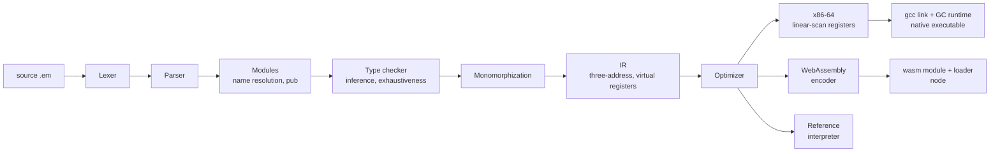

<div align="center">

<picture>
  <source media="(prefers-color-scheme: dark)" srcset="assets/wordmark-dark.png">
  
</picture>

**A statically typed programming language with its own optimizing compiler.**
Written in C++17 with no dependencies: lexer, type checker, optimizer, x86-64 and WebAssembly back ends, and a garbage collector.


[**Try it online**](https://ember-lang.vercel.app) · [Quick start](#-quick-start) · [Highlights](#-highlights) · [How it works](#%EF%B8%8F-how-it-works) · [How it is tested](#-how-it-is-tested) · [Performance](#-performance) · [Language reference](#-language-reference)

</div>

---

```rust
import "std/iter.em" as iter;

enum Shape { Circle(float), Rect(float, float) }

fn area(s: Shape) -> float {
    match s {
        Circle(r) => { return 3.14159 * r * r; }
        Rect(w, h) => { return w * h; }
    }
}

fn main() -> int {
    let shapes = [Shape.Circle(1.0), Shape.Rect(2.0, 3.0)];
    let areas = iter.map(shapes, area);
    let k = 2.0;
    print(iter.count(areas, fn(a: float) -> bool { return a > k; }));
    return 0;
}
```

The same program compiles to a native Linux executable, to WebAssembly running on node, or runs on the reference interpreter, and all three must print exactly the same thing.

## 🌐 Try it online

**[ember-lang.vercel.app](https://ember-lang.vercel.app)** runs the real compiler in your browser, built from the same C++ source to WebAssembly. Write a program, run it, and watch it become IR, optimized IR and x86-64 assembly. Nothing to install. The playground's source is in [`playground/`](playground/).

## ✨ Highlights

<table>
<tr>
<td width="50%" valign="top">

### 🧠 Language
- Structs, enums with payloads, exhaustive `match`
- Generics with type inference, compiled by monomorphization
- Closures and first-class functions
- Modules with `pub` / private names
- Error messages with a caret under the exact problem

</td>
<td width="50%" valign="top">

### ⚡ Compiler
- 15+ optimizer passes: constant propagation, CSE, LICM, inlining, tail calls, bounds-check elimination
- Linear-scan register allocation (11 registers)
- Hand-written x86-64 and WebAssembly encoders
- DWARF debug info, so gdb can break on Ember lines

</td>
</tr>
<tr>
<td width="50%" valign="top">

### ♻️ Runtime
- Generational, non-moving garbage collector
- Card-marking write barrier
- Heap limit, GC pause statistics, stress mode
- Stack-overflow detection

</td>
<td width="50%" valign="top">

### 🧪 Verification
- Every test runs on **6 execution paths** that must agree
- Expected outputs come from independent Python, never from Ember
- Differential fuzzer with an automatic test-case shrinker
- 408 checks, 1000/1000 fuzz programs agreed

</td>
</tr>
</table>

## 🚀 Quick start

> **Needs:** Linux x86-64 (on Windows, use WSL), `g++`, `gcc`, `make`, `python3`.
> The WebAssembly target also needs `clang`, `lld` and `node`.

```bash
make                                  # builds the compiler: ./embc
./embc examples/showcase.em --run     # a tour of the language
make test                             # the full suite: 408 checks
```

Your first program, `hello.em`:

```rust
// comments use //, or /* ... */ for several lines
fn main() -> int {
    print("Hello, World!");

    let mut total = 0;
    for i in 0..10 {
        total += i * i;
    }
    print("sum of squares: " + str(total));
    return 0;
}
```

```bash
./embc hello.em --run
```

<details>
<summary><b>📋 All commands</b></summary>

```bash
./embc prog.em -o prog && ./prog       # native x86-64 executable
./embc prog.em --run -- arg1 arg2      # compile and run, with program arguments
./embc prog.em --interp                # run on the reference interpreter (no gcc needed)
./embc prog.em --target wasm -o p.js   # WebAssembly: run with `node p.js`
./embc prog.em --test                  # run every `fn test_*()` in the file and report
./embc fmt prog.em [-w] [--check]      # format: print, rewrite, or fail if unformatted
./embc prog.em -g -o prog              # with DWARF line info: gdb can `break prog.em:12`
./embc prog.em --emit-ir               # the intermediate representation
./embc prog.em --emit-asm              # the generated x86-64 assembly
./embc prog.em --stats                 # optimizer statistics
./embc prog.em -O0                     # optimizer off
make test                              # every program on interpreter, x86-64 and wasm, at -O0 and -O1
make stress                            # the suite with a garbage collection on every allocation
make fuzz                              # differential fuzzer
```

**Runtime knobs** (environment variables of the compiled program):

| Variable | Effect |
|---|---|
| `EMBER_HEAP_MB=N` | fail with "out of memory" instead of growing the heap past N MB |
| `EMBER_GC_STATS=1` | print collector statistics and pause times at exit |
| `EMBER_GC_STRESS=N` | collect on every Nth allocation |
| `EMBER_GC_FULL=1` | only full collections (for comparison) |

**Compiler knob:** `EMBER_NO_OPT=pass,pass` turns optimizer passes off (`coalesce`, `cse`, `licm`, `gconst`, `bce`, `strength`, `inline-nonleaf`). This is how `docs/PERF.md` measures each pass.

</details>

## ⚙️ How it works



What the optimizer does to a simple loop (`./embc hello.em --emit-ir`, before and after):

<table>
<tr><th>-O0 (14 instructions)</th><th>-O1 (10 instructions)</th></tr>
<tr>
<td>

```
  r0 = mov 0
  r2 = mov 0
  r3 = mov 10
L0:
  r4 = lt r2, r3
  br r4, L1, L3
L1:
  r1 = mov r2
  r5 = mul r1, r1
  r6 = add r0, r5
  r0 = mov r6
L2:
  r2 = add r2, 1
  jmp L0
L3:
  print_int r0
  ret 0
```

</td>
<td>

```
  r0 = mov 0
  r2 = mov 0
L0:
  r4 = lt r2, 10
  br r4, L1, L3
L1:
  r5 = mul r2, r2
  r0 = add r0, r5
  r2 = add r2, 1
  jmp L0
L3:
  print_int r0
  ret 0
```

</td>
</tr>
</table>

Constant propagation folded `r3` into the comparison, copy propagation removed `r1`, coalescing merged `r6` into `r0`, and the empty block and the dead `ret` disappeared. The register allocator then keeps `total` and `i` in `rsi` and `rdi` for the whole loop, so it never touches memory.

## 🧪 How it is tested

Every program in `tests/programs` runs on **six paths**, and all six must produce byte-identical output and the same exit code:

| | -O0 | -O1 |
|---|:---:|:---:|
| **Reference interpreter** | ✅ | ✅ |
| **Native x86-64** | ✅ | ✅ |
| **WebAssembly (node)** | ✅ | ✅ |

| Check | Result |
|---|---|
| `make test` | **408 passed, 0 failed** (52 programs × 6 paths, 71 compile-error tests, 25 tooling checks) |
| `make stress` (GC on every allocation) | **200 passed, 0 failed** |
| Differential fuzzer, all six paths | **1000 / 1000 programs agreed** |
| Fuzzer with GC stress | **500 / 500 agreed** |
| Formatter | idempotent on all 160 `.em` files |

**Checking the checks.** Reinserting a fixed inliner bug made the fuzzer catch it in 3 of 30 programs, and the shrinker cut the failing program from 51 lines to 16. Disabling the GC write barrier made 8 stress runs fail.

<details>
<summary><b>🐛 Real bugs these tests found</b></summary>

| Bug | Found by | Root cause |
|---|---|---|
| String and vector code gave different results at -O1 | differential testing | the inliner renumbered registers in instruction operands but not in runtime-call argument lists |
| Compiler crash on `Box { v: x }` inside a generic function | fuzzer | a reference into the type table was invalidated when instantiation grew the table |
| `-nan` vs `nan` from `pow(-1.0, 0.5)` on wasm | fuzzer | JavaScript returns a positive NaN, glibc the negative x86 default |
| `parse_int("  -17")` returned 0 | Python reference | leading whitespace was not skipped |
| `x & 1 == 1` parsed as `x & (1 == 1)` | review | C's precedence mistake; now Rust/Go order |

</details>

## 📊 Performance

Measured on a 2-vCPU Xeon VM; full method and tables in [`docs/PERF.md`](docs/PERF.md).

**Register allocator and optimizer work (before → after):**

| Benchmark | Speedup | Instructions executed |
|---|:---:|---|
| fib (recursive) | **2.10×** | 942M → 918M |
| hashmap (1M inserts, 2M lookups) | **2.01×** | 985M → 542M |
| quicksort (5M ints) | **1.65×** | 3,971M → 2,232M |
| nbody (2M steps) | **1.65×** | 6,202M → 4,568M |
| string building (20 MB) | **1.50×** | 4,855M → 3,622M |

**Garbage collector:** on binary trees, generational collection cut total GC time **2.6×** (345 → 131 ms) and mean pause **2.8×** versus full collections. On allocation-heavy benchmarks, Ember runs **4.4–6.8× faster than Python** and within **1.4–1.7× of C** using malloc/free.

## 📖 Language reference

<details>
<summary><b>Types</b></summary>

| Type | Meaning |
|---|---|
| `int` | 64-bit signed integer; arithmetic wraps around on overflow |
| `float` | IEEE 754 double |
| `bool` | `true` or `false` |
| `str` | immutable string of bytes; `s[i]` is the byte at `i` (an int), `len(s)` its length |
| `[T]` | array of T, fixed length, mutable elements; `[byte]` and `[bool]` use one byte per element |
| `Name` | a declared struct or enum (a reference; may be `null`) |
| `Name<T, ...>` | an instance of a generic struct or enum |
| `fn(A, B) -> R` | a function value (a top-level function or a closure); `fn(A)` returns nothing |

`byte` exists only as an array element type: `[byte]` elements are read as ints 0..255 and store the low 8 bits.
Structs, enums, arrays and function values are references: `==` compares identity, and they may be `null`
(`let p: Point = null;`). Every other type is compared by value (`str` too).

</details>

<details>
<summary><b>Declarations</b></summary>

```rust
import "std/math.em" as math;          // qualified access: math.abs(x), math.PI, vec.Vec<int>
import "util.em";                      // unqualified access to util.em's pub names
pub const LIMIT = 100;                 // constants: int, float, bool, char or str literals
pub struct Point { x: int, y: int }
struct Pair<A, B> { first: A, second: B }
pub enum Option<T> { Some(T), None }   // variants carry 0..6 values
pub fn add(a: int, b: int) -> int { return a + b; }
fn swap<A, B>(p: Pair<A, B>) -> Pair<B, A> { return Pair { first: p.second, second: p.first }; }
fn main() -> int { return 0; }         // the entry point; its result is the exit code
```

Every top-level name is private to its file unless declared `pub`. A file's own declarations come first, then the
built-in functions, then the names imported without `as`; two `as`-less imports that both define a name make an
unqualified use of it an error (qualify it). Functions take at most 6 parameters (5 when used as values).

</details>

<details>
<summary><b>Statements</b></summary>

```rust
let x = 1;                  let mut y: float = 2.0;          // `let` is immutable; `let mut` can be reassigned
y = y * 2.0;                x += 1;  // also -= *= /= %= &= |= ^= <<= >>=
if c { ... } else if d { ... } else { ... }
while c { ... }             for i in 0..n { ... }            // i runs from 0 up to n - 1
break;  continue;  return v;
match shape {
    Circle(r) => { ... }
    Rect(w, _) => { ... }   // `_` ignores a value
    _ => { ... }            // anything else
}
```

A `match` must cover every variant (or have a `_` arm); a missing variant is a compile error that names it.
Only calls can be expression statements. A function that returns a value must return on every path.

</details>

<details>
<summary><b>Expressions and operators</b></summary>

Operators, from loosest to tightest binding (all left-associative):

| Operator | Meaning |
|---|---|
| `\|\|` | logical or (short-circuit) |
| `&&` | logical and (short-circuit) |
| `== !=` | equality |
| `< <= > >=` | ordering (ints, floats, strs) |
| `\|` | bitwise or |
| `^` | bitwise xor |
| `&` | bitwise and |
| `<< >>` | shifts (`>>` is arithmetic; the count is taken mod 64) |
| `+ -` | add, subtract (`+` also concatenates strs) |
| `* / %` | multiply, divide (truncates toward zero), remainder (sign of the dividend) |
| `- ! ~` | unary negate, not, bitwise not |

Bitwise operators bind tighter than comparisons, so `x & 1 == 1` means `(x & 1) == 1` (as in Rust and Go).
Ints and floats never mix implicitly: write `float(i)` or `int(x)`.

**Literals:** `42`, `0xFF`, `0b1010`, `1_000_000`, `1.5`, `2.0e-3`, `'a'` (an int), `"text\n"` (escapes `\n \t \r \0 \\ \" \' \xHH`),
`true`, `false`, `null`, arrays `[1, 2, 3]`.

**Other expressions:** `a[i]`, `p.x`, `f(x)`, `math.abs(x)`, `Point { x: 1, y: 2 }`, `Pair<int, str> { ... }`,
`Shape.Circle(1.0)`, `Option<int>.None`, `new [int](n)` (a zeroed array: 0, 0.0, false, "" or null), `id<str>` (a
generic function as a value), and anonymous functions `fn(x: int) -> int { return x + k; }`.

</details>

<details>
<summary><b>Generics</b></summary>

Structs, enums and functions can be generic. Type arguments are inferred from the arguments and then from the type
the context expects, and can always be written: `vec.make<int>()`. Generic code is checked once, with each type
parameter treated as an opaque type, so a value of type `T` can be stored, passed, returned and compared with `==`,
but not printed or added. The compiler then makes one copy of each generic function per list of type arguments it is
used with (monomorphization), so generic code runs as fast as hand-written code.

</details>

<details>
<summary><b>Closures</b></summary>

An anonymous function can use the variables around it. **Closures capture by value**: each one gets a copy of the
variables it uses, made when it is created, and assigning to a captured variable is a compile error. Ember's local
variables live in registers and stack slots that disappear when their function returns, while a closure can outlive
that function, so a copy is the semantics that stays predictable. To share mutable state, capture a reference (a
struct or an array) and change its contents:

```rust
fn make_counter() -> fn() -> int {
    let c = Counter { n: 0 };
    return fn() -> int { c.n += 1; return c.n; };
}
```

</details>

<details>
<summary><b>Built-in functions</b></summary>

| Group | Functions |
|---|---|
| output | `print(x)` (int, float, bool or str, plus a newline; floats print with 6 decimals), `put(s)` (no newline) |
| input | `read_int()`, `read_line()`, `at_eof()` |
| strings | `len(s)`, `substr(s, start, count)`, `chr(c)`, `str(x)`, `parse_int(s)`, `str_from_bytes(bytes, n)` |
| arrays | `len(a)`, `new [T](n)` |
| numbers | `int(x)`, `float(i)`, `sqrt sin cos tan atan atan2 exp log pow floor ceil` |
| files | `read_file(path)`, `write_file(path, s)`, `append_file(path, s)`, `file_exists(path)` |
| process | `arg_count()`, `arg(i)`, `env(name)` ("" if unset), `has_env(name)`, `exit(code)`, `clock_ns()` |
| errors | `panic(message)`, `assert(condition)` |

</details>

<details>
<summary><b>Runtime errors</b></summary>

These stop the program with `runtime error: <what> (line N)` and exit code 1: index out of bounds, division by zero,
negative array size, out of memory, null dereference, failed assert, panic, a file that cannot be read or written,
stack overflow. `int(x)` of a NaN or out-of-range float gives the smallest int, as the hardware does.

</details>

<details>
<summary><b>Standard library</b></summary>

Written in Ember and embedded in the compiler: `import "std/<name>.em" as <name>;`

| Module | Contents |
|---|---|
| `vec` | `Vec<T>`: make, with_capacity, from_array, size, is_empty, push, get, get_opt, set, pop, last, clear, to_array, index_of, contains, reverse, sum |
| `option` | `Option<T>` (Some / None): some, none, is_some, is_none, unwrap, unwrap_or |
| `iter` | map, filter, fold, any, all, count, each, find_index, range, tabulate, zip_with |
| `str` | split, join, find, contains, count, replace, trim, upper, lower, reverse, repeat, pad_left, starts_with, ends_with, ... |
| `strbuf` | `StrBuf`, a string builder: make, push, push_char, push_int, size, clear, to_str |
| `map` | `IntMap`, a hash map from int to int: make, put, get, has, size, keys |
| `sort` | ints, floats (quicksort), strs (stable merge sort), is_sorted, search |
| `math` | abs, sign, min, max, clamp, mod, gcd, lcm, pow, isqrt, is_prime, fabs, fmin, fmax, PI, E |
| `rand` | `Rng`, a deterministic 64-bit LCG: make, next, range, next_float, shuffle |
| `io` | read_ints, read_lines |

The prefixed names from before modules (`vec_push`, `math_abs`, ...) still work for one release through
`std/compat/`, with a deprecation warning; the old types `IntVec` and `StrVec` are now `vec.Vec<int>` and `vec.Vec<str>`.

</details>

## 🗂️ Project layout

```
src/        the compiler: lexer, parser, modules, sema, mono, ir, opt, codegen (x86-64), wasm, interp, fmt
rt/         runtimes: native C runtime with the GC, wasm runtime, node loader
std/        the standard library, written in Ember
tests/      test runner, independent Python reference, fuzzer, benchmarks
docs/       STATUS.md (what is done and how it was verified), PERF.md (measurements)
examples/   showcase.em, a tour of the language
```

## ⚠️ Known limits

- Linux x86-64 only; native output needs gcc to assemble and link.
- The WebAssembly target has no garbage collector yet (memory is bump-allocated).
- Floats are not register-allocated: they go through `xmm0`/`xmm1` as scratch registers.
- The collector is conservative, so an integer that looks like a pointer can keep an object alive.

See [`docs/STATUS.md`](docs/STATUS.md) for the full list and the design decisions behind each one.

---

<div align="center">

A personal project by **Muneeb**.

</div>
